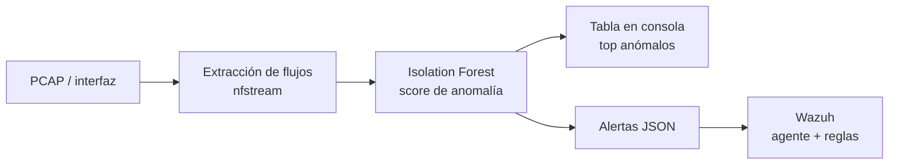
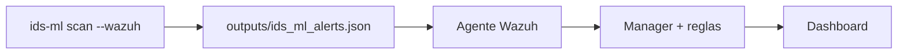

<div align="center">

# 🛡️ IDS-ML

### Analizador de capturas de red con detección de anomalías por Machine Learning e integración con Wazuh

*Le pasas un PCAP, aprende cómo es tu tráfico normal y te marca los flujos sospechosos — con una explicación de por qué — y manda las alertas a Wazuh.*


</div>

## Tabla de contenidos

- [¿Qué hace?](#qué-hace)
- [Cómo funciona](#cómo-funciona)
- [Instalación](#instalación)
- [Uso rápido](#uso-rápido)
- [Ejemplo de salida](#ejemplo-de-salida)
- [Integración con Wazuh](#integración-con-wazuh)
- [Estructura del proyecto](#estructura-del-proyecto)
- [Configuración](#configuración)
- [Desarrollo y tests](#desarrollo-y-tests)
- [Preguntas frecuentes](#preguntas-frecuentes)

## ¿Qué hace?

Los IDS por firmas (Snort, Suricata) solo ven lo que ya conocen. `IDS-ML` toma
el enfoque contrario: **aprende cómo es el tráfico normal de tu red** y señala
cualquier flujo que se salga de ese patrón. Así cubre también comportamientos
nunca vistos, sin necesitar un dataset etiquetado de ataques.

- ✅ **Sin etiquetas**: entrena solo con tráfico legítimo tuyo.
- ✅ **Explicable**: cada alerta dice *qué* característica del flujo se dispara.
- ✅ **Integrado**: alertas JSON listas para Wazuh (agente → reglas → dashboard).
- ✅ **Python puro**: extracción de flujos con `nfstream`, sin Java/CICFlowMeter.

## Cómo funciona



Más detalle en [docs/architecture.md](docs/architecture.md).

## Instalación

```bash
# 1) Entorno virtual
python -m venv .venv
.venv\Scripts\activate            # Windows  (Linux/mac: source .venv/bin/activate)

# 2) Instalar la herramienta (deja disponible el comando `ids-ml`)
pip install -e .
```

> **Windows:** instala también **[Npcap](https://npcap.com)** en modo
> *"WinPcap API compatible"*. `nfstream` lo necesita para leer PCAP y capturar
> en vivo.

## Uso rápido

```bash
# 1) Enseñarle tu tráfico normal (una sola vez)
ids-ml train normal_lunes.pcap normal_martes.pcap

# 2) Analizar una captura sospechosa
ids-ml scan sospechoso.pcap

# 3) Analizar y mandar alertas a Wazuh
ids-ml scan sospechoso.pcap --wazuh

# Capturar en vivo de una interfaz
ids-ml live "Wi-Fi" --seconds 60 --wazuh

# Ver el estado del modelo entrenado
ids-ml info
```

Guía completa en [docs/usage.md](docs/usage.md).

## Ejemplo de salida

> ℹ️ Los bloques siguientes son **ejemplos representativos** de la salida en
> consola. (Cuando lo ejecutes con tus capturas, sustituimos esto por capturas
> de pantalla reales.)

**Entrenamiento:**

```text
$ ids-ml train normal_lunes.pcap normal_martes.pcap
Entrenando detector con 2 captura(s)…
[10:12:03] INFO     Flujos extraídos: 48213
[10:12:07] INFO     Detector entrenado con 48213 flujos normales.
[10:12:07] INFO     Modelo guardado en models/anomaly_model.joblib
Listo. 48213 flujos, 20 características. Ya puedes usar 'scan'.
```

**Análisis de una captura:**

```text
$ ids-ml scan sospechoso.pcap --top 5 --wazuh
Extrayendo flujos de sospechoso.pcap …
[10:15:29] INFO     Flujos extraídos: 1204
Flujos analizados: 1204

                         Flujos más anómalos (top 5)
┏━━━━━━━┳━━━━━━━━━━┳━━━━━━━━━━━━━━━━━━┳━━━━━━━━━━━━━━┳━━━━━━━┳━━━━━━━━━━━━━━━━━━━━━━━━┓
┃ Score ┃ Severidad┃ Origen           ┃ Destino      ┃ Proto ┃ Factores destacados    ┃
┡━━━━━━━╇━━━━━━━━━━╇━━━━━━━━━━━━━━━━━━╇━━━━━━━━━━━━━━╇━━━━━━━╇━━━━━━━━━━━━━━━━━━━━━━━━┩
│  0.94 │ high     │ 10.0.0.99:6666   │ 8.8.8.8:53   │  17   │ bytes=+7.4, pkts=+6.9  │
│  0.88 │ high     │ 10.0.0.50:49210  │ 45.9.1.2:443 │   6   │ duration=+5.1, syn=+4. │
│  0.71 │ medium   │ 10.0.0.12:52133  │ 10.0.0.1:445 │   6   │ rst=+3.8, pkts=+2.2    │
│  0.63 │ medium   │ 10.0.0.31:33455  │ 10.0.0.2:22  │   6   │ syn=+3.1               │
│  0.22 │ low      │ 10.0.0.12:52140  │ 10.0.0.1:443 │   6   │ mean_ps=+0.9           │
└───────┴──────────┴──────────────────┴──────────────┴───────┴────────────────────────┘

2 alerta(s) escritas en outputs/ids_ml_alerts.json
```

## Integración con Wazuh

Con `--wazuh`, las alertas se escriben en `outputs/ids_ml_alerts.json` y el
agente de Wazuh las recoge. Tienes el bloque de `ossec.conf` y reglas de
ejemplo listas para copiar en [`examples/wazuh/`](examples/wazuh/), y la guía
paso a paso en [docs/wazuh-integration.md](docs/wazuh-integration.md).



## Estructura del proyecto

```
ProyectoCiber/
├── src/ids_ml/              # Paquete principal
│   ├── config.py            # Parámetros y rutas (configurable por entorno)
│   ├── logging_conf.py      # Logging con salida enriquecida
│   ├── features.py          # Extracción de flujos (nfstream)
│   ├── detector.py          # Entrenamiento y scoring (Isolation Forest)
│   ├── wazuh.py             # Emisión de alertas JSON para Wazuh
│   └── cli.py               # CLI: comando `ids-ml`
├── tests/                   # Tests (pytest, con datos sintéticos)
├── docs/                    # architecture · usage · wazuh-integration
├── examples/wazuh/          # Decoder/reglas y snippet de ossec.conf
├── models/                  # Modelo entrenado (generado)
├── outputs/                 # Alertas para Wazuh (generado)
├── pyproject.toml           # Empaquetado y dependencias
├── Makefile                 # Atajos de desarrollo
└── .env.example             # Variables de configuración
```

## Configuración

Todo es configurable por variables de entorno (copia `.env.example` a `.env`):

| Variable | Por defecto | Qué controla |
|---|---|---|
| `IDS_ML_HOME` | raíz del repo | dónde se guardan modelos y salidas |
| `IDS_ML_CONTAMINATION` | `0.02` | proporción esperada de anómalos al entrenar |
| `IDS_ML_ALERT_THRESHOLD` | `0.6` | score mínimo para emitir alerta a Wazuh |
| `IDS_ML_LOG_LEVEL` | `INFO` | nivel de log |

## Desarrollo y tests

```bash
pip install -e ".[dev]"
pytest            # ejecutar los tests
ruff check src    # estilo
mypy src          # tipos
```

Los tests usan datos sintéticos y **no requieren nfstream ni PCAP reales**, así
que corren en cualquier equipo.

## Preguntas frecuentes

**¿Necesito un dataset de ataques?** No. Entrenas solo con tráfico normal tuyo.

**¿Y si mi red cambia?** Reentrena con capturas nuevas (`ids-ml train …`).

**¿Funciona con tráfico cifrado?** Sí: trabaja con *metadatos* del flujo
(tamaños, tiempos, banderas TCP), no con el contenido, así que el cifrado no le
afecta.

**¿Reemplaza a Suricata/Snort?** No, lo complementa: ellos cubren lo conocido
por firmas; esto cubre lo anómalo/desconocido.

<div align="center">
<sub>Proyecto personal · MIT · hecho para el día a día de análisis de red</sub>
</div>
