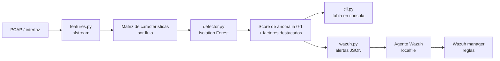
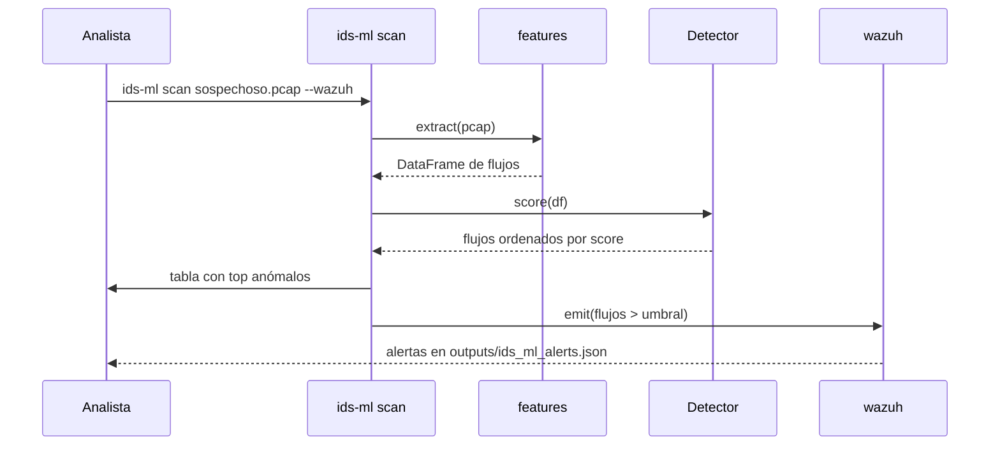

# Arquitectura

## Visión general

`ids-ml` convierte una captura de red en una lista priorizada de flujos
sospechosos, aprendiendo previamente cómo es el tráfico **normal** de tu red.

## Componentes

| Módulo | Responsabilidad | Entrada | Salida |
|---|---|---|---|
| `features.py` | Extraer flujos y características | PCAP / interfaz | DataFrame de flujos |
| `detector.py` | Aprender lo normal y puntuar | DataFrame | `ScoredFlow[]` |
| `wazuh.py` | Emitir alertas | `ScoredFlow[]` | JSON-lines |
| `cli.py` | Orquestar y mostrar | argumentos | tabla / alertas |
| `config.py` | Parámetros y rutas | entorno | `Settings` |

## ¿Por qué detección de anomalías no supervisada?

- **No necesitas etiquetas.** No vas a tener un dataset etiquetado de ataques
  de *tu* red. El Isolation Forest solo necesita tráfico normal.
- **Detecta lo desconocido.** Al modelar "lo normal", cualquier desviación
  (incluidos patrones nunca vistos) sube de score, cubriendo el caso de día cero.
- **Interpretable.** Como las características van estandarizadas, el |z-score|
  más alto señala directamente qué métrica del flujo se dispara (p. ej. muchos
  bytes, muchos paquetes SYN, duración anómala).

## Decisiones de diseño

1. **Un único extractor** para entrenamiento e inferencia → sin descuadre de
   características.
2. **Escalado ajustado solo con el tráfico de entrenamiento**; en scoring se
   aplica `transform`, nunca `fit` → sin fuga de datos.
3. **Import diferido de nfstream** dentro de `features.py` → el paquete se
   puede importar y testear sin tener nfstream/Npcap instalados.
4. **Configuración por entorno** (`Settings`) → nada de rutas fijas en el
   código; portable entre equipos.

## Flujo de inferencia

