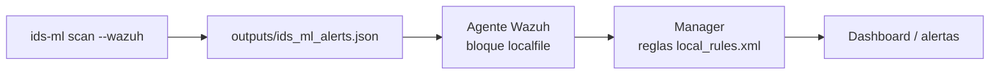

# Integración con Wazuh

`ids-ml` no toca la API de Wazuh. Escribe las alertas en un fichero JSON-lines
y deja que el **agente** las recoja. Es la vía más simple y robusta.



## Paso 1 — Generar alertas

```bash
ids-ml scan sospechoso.pcap --wazuh
```

Esto añade líneas a `outputs/ids_ml_alerts.json`. Cada línea es un evento:

```json
{
  "timestamp": "2026-10-02T10:15:30+00:00",
  "integration": "ids-ml",
  "source_capture": "sospechoso.pcap",
  "anomaly_score": 0.91,
  "severity": "high",
  "src": "10.0.0.99:6666",
  "dst": "8.8.8.8:53",
  "protocol": 17,
  "top_features": [
    {"feature": "bidirectional_bytes", "scaled_value": 7.42},
    {"feature": "bidirectional_packets", "scaled_value": 6.88}
  ]
}
```

## Paso 2 — Configurar el agente

Copia el bloque de [`examples/wazuh/ossec-localfile-snippet.xml`](../examples/wazuh/ossec-localfile-snippet.xml)
dentro de `<ossec_config>` en el `ossec.conf` del agente, ajustando la ruta.
Reinicia el agente.

Wazuh decodifica el JSON automáticamente: cada campo queda disponible como
`json.anomaly_score`, `json.severity`, `json.src`, etc.

## Paso 3 — Reglas en el manager

Copia [`examples/wazuh/local_rules.xml`](../examples/wazuh/local_rules.xml) a
`/var/ossec/etc/rules/local_rules.xml` en el manager y reinícialo. Tendrás:

| Regla | Nivel | Dispara con |
|---|---|---|
| 100200 | 3 | cualquier evento de ids-ml |
| 100201 | 7 | `severity = medium` |
| 100202 | 12 | `severity = high` |

## Paso 4 (opcional) — Respuesta activa

Con la regla 100202 (nivel 12) puedes enganchar un *active response* de Wazuh
para, por ejemplo, bloquear la IP de origen. Eso ya es contención automática;
configúralo con cuidado y solo sobre fuentes de confianza para no bloquearte a
ti mismo por un falso positivo.

> Consejo: empieza en modo observación (sin respuesta activa), ajusta el
> `--threshold` hasta tener pocos falsos positivos, y solo entonces automatiza.
